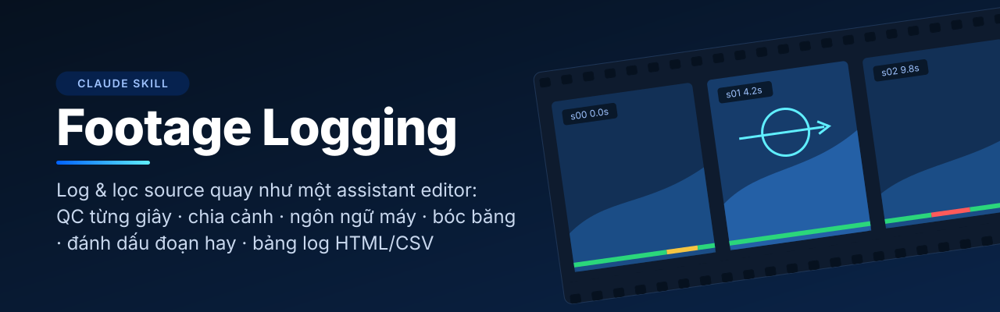
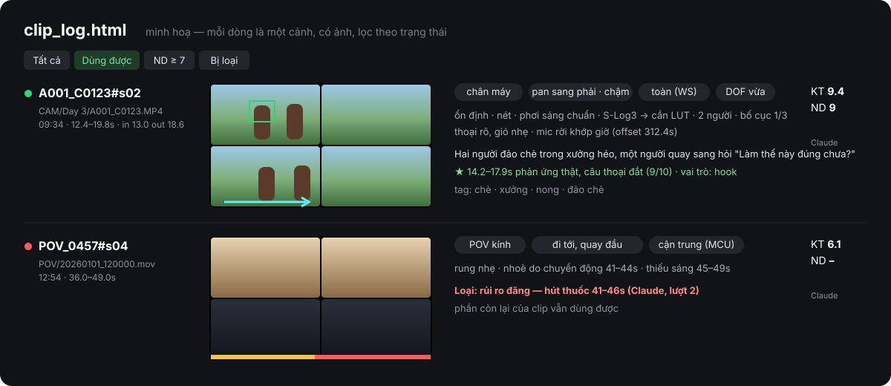
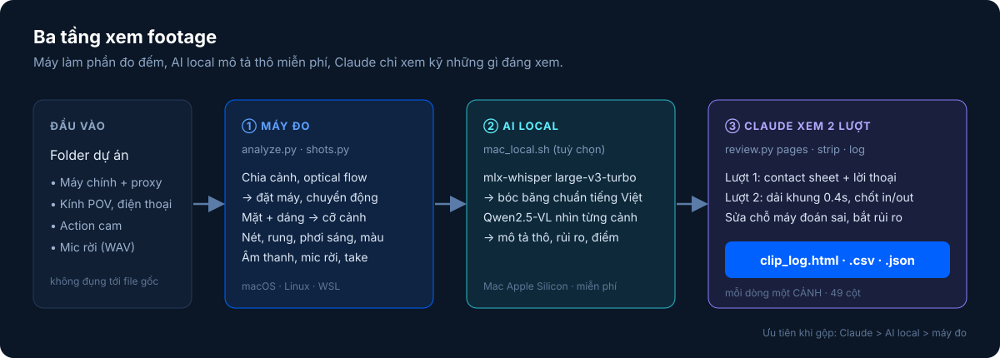

<p align="center">
  
</p>

<p align="center">
  <a href="#cài-đặt"></a>
  
  
  
  <a href="LICENSE"></a>
</p>

<p align="center">
  <b>Đưa Claude một folder footage. Nhận lại bảng log từng cảnh như assistant editor ngồi log cả ngày.</b><br>
  <sub>Tiếng Việt · <a href="#english">English summary</a></sub>
</p>

---

Sau một buổi quay bạn có vài trăm clip từ máy chính, kính POV, điện thoại, mic rời. **Footage Logging** là một
[Claude Skill](https://support.claude.com/en/articles/12512180-use-skills-in-claude) kèm bộ script giúp Claude/Muse
**xem hết** chỗ đó: QC kỹ thuật từng giây, chia cảnh, nhận ra cú máy (chân máy / gimbal / cầm tay, pan / tilt / push / zoom…),
cỡ cảnh, nét, rung, bóc băng, mô tả việc đang diễn ra, đánh dấu đoạn hay, loại đoạn hỏng hoặc có rủi ro khi đăng,
rồi xuất bảng log HTML / CSV / JSON để bạn (hoặc bước dựng tiếp theo) dùng ngay.

<p align="center">
  
</p>

## Mục lục

- [Nó làm gì](#nó-làm-gì)
- [Cách hoạt động](#cách-hoạt-động)
- [Yêu cầu](#yêu-cầu)
- [Cài đặt](#cài-đặt)
- [Dùng với Claude](#dùng-với-claude)
- [Chạy tay từng bước](#chạy-tay-từng-bước)
- [Kết quả](#kết-quả)
- [Hiệu chỉnh theo mắt bạn](#hiệu-chỉnh-theo-mắt-bạn)
- [Cấu hình](#cấu-hình)
- [Hiệu năng](#hiệu-năng)
- [Riêng tư](#riêng-tư)
- [Giới hạn](#giới-hạn)
- [Khắc phục sự cố](#khắc-phục-sự-cố)
- [Cấu trúc repo](#cấu-trúc-repo)
- [Đóng góp](#đóng-góp) · [Giấy phép](#giấy-phép)

## Nó làm gì

Mỗi dòng trong bảng log là **một cảnh** (không phải một clip), với 49 cột chia 5 nhóm:

| Nhóm | Tiêu chí |
|---|---|
| **Ngôn ngữ máy** | cách đặt máy (chân máy · gimbal · slider/dolly · cầm tay · POV · action cam) · chuyển động (pan, tilt, push/pull, zoom, truck, pedestal, follow, roll + hướng, tốc độ) · cỡ cảnh ECU → EWS · góc máy · DOF · bố cục 1/3 · headroom · crop 9:16 đề xuất |
| **Kỹ thuật** | ổn định (rung, lia gắt) · nét (out nét, lệch nét, focus hunting, nhoè) · phơi sáng (cháy/sập) · flicker · nhiễu · ám màu · vật cản rìa khung · profile màu (S-Log3 / HLG / Rec709) · slow-mo · điểm KT 0–10 |
| **Nội dung** | loại cảnh (phỏng vấn, B-roll, establishing, insert, phản ứng, hậu trường…) · bối cảnh · người · hành động · mô tả · tag · thời điểm trong ngày |
| **Âm thanh** | có thoại / nhạc / tiếng hiện trường · gió · clip đỉnh · mức dB · lời thoại (transcript) · file mic rời khớp giờ |
| **Biên tập** | in / out đề xuất · đoạn hay (giây + lý do + điểm) · điểm nội dung · vai trò (hook, thân, trám, kết, payoff) · nhóm take & take tốt nhất · rủi ro khi đăng (hút thuốc, trẻ em, người lạ, màn hình tin nhắn, giấy tờ, biển số…) · dùng được / lý do loại |

Ngoài ra skill viết **báo cáo một phút đọc**: bao nhiêu clip dùng được, file hỏng, 5–8 khoảnh khắc mạnh nhất,
các đoạn phải loại vì nội dung, và vài ý tưởng video rút ra từ chính source.

## Cách hoạt động

<p align="center">
  
</p>

1. **Máy đo** (`analyze.py`, `shots.py`). Chạy trên máy chứa footage, không cần GPU. Đo mọi thứ đo được bằng thuật toán:
   optical flow → cú máy; nhận diện mặt và dáng người → cỡ cảnh; độ nét, rung, phơi sáng, màu, âm thanh. Vẽ contact sheet có chú thích
   (mũi tên hướng máy, khung mặt, thanh xanh/vàng/đỏ theo từng giây).
2. **AI local** (tuỳ chọn, Mac Apple Silicon, miễn phí). `mlx-whisper large-v3-turbo` bóc băng (tiếng Việt chuẩn hơn hẳn Whisper small),
   `Qwen2.5-VL` nhìn từng cảnh và viết mô tả thô. Chạy được qua đêm, không tốn lượt Claude.
3. **Claude/Muse xem 2 lượt.** Lượt 1 xem contact sheet + lời thoại của toàn bộ dự án. Lượt 2 xem dải khung 0.4 giây ở những đoạn ứng viên
   để chốt in/out, sửa chỗ máy đoán sai, bắt rủi ro mà máy không thấy. Khi gộp bảng: **Claude > AI local > máy đo**.

## Yêu cầu

| | Bắt buộc | Tuỳ chọn |
|---|---|---|
| Hệ điều hành | macOS hoặc Linux (Windows: qua WSL2, chưa thử) | Mac Apple Silicon (M1–M4) cho AI local |
| Phần mềm | `ffmpeg`, Python 3.9+ (`opencv-python-headless`, `numpy`, `pillow`) | `mediapipe==0.10.14` (cần Python ≤ 3.12) cho nhận diện người chính xác · Node 18+ cho Whisper small |
| Claude / Muse | Gói có Skills + code execution, hoặc [Claude Code](https://docs.claude.com/en/docs/claude-code/overview), hoặc Muse | |
| Ổ đĩa | ~2GB trống cho cache | ~7GB cho model AI local |

`tools/setup.sh` kiểm tra và cài phần Python cho bạn.

## Cài đặt

### Cách 1 — Claude Code (khuyên dùng)

Claude Code chạy ngay trên máy có footage nên đọc thẳng được file và tự chạy được cả phần AI local trên Mac.

```bash
git clone https://github.com/kieentrong/footage-logging ~/.claude/skills/footage-logging
bash ~/.claude/skills/footage-logging/tools/setup.sh
```

Mở Claude Code trong (hoặc cạnh) folder dự án và nói *"log source folder này giúp mình"*.

### Cách 2 — Ứng dụng Claude (web / desktop)

1. Tải `footage-logging.zip` ở trang [Releases](../../releases), hoặc tự đóng gói: `bash scripts/build-skill-zip.sh` → `dist/footage-logging.zip`.
   *(Không dùng nút "Download ZIP" của GitHub: tên thư mục bên trong sẽ là `footage-logging-main`, không khớp tên skill.)*
2. Bật **Settings → Capabilities → Code execution and file creation**.
3. Vào **Customize → Skills → + → Create skill → Upload a skill**, chọn file zip.

> Footage thường nặng hàng trăm GB, không tải lên chat được. Ở ứng dụng Claude, skill phát huy tốt nhất khi Claude
> truy cập được folder trên máy bạn (ứng dụng desktop có quyền vào folder), hoặc khi bạn chạy phần máy đo bằng tay
> ([cách 3](#chạy-tay-từng-bước)) rồi đưa Claude thư mục `_SOCIAL/analysis/`.

### Cách 3 — Không dùng Claude cho phần máy đo

```bash
git clone https://github.com/kieentrong/footage-logging && cd footage-logging
bash tools/setup.sh
```
Rồi chạy các lệnh ở [Chạy tay từng bước](#chạy-tay-từng-bước).

### Cách 4 — Muse

Cài skill vào thư mục custom skills của Muse (`~/workspace/custom-skills/footage_logging/`, gồm `SKILL.md`,
`tools/`, `docs/` và một `skill.yaml` trỏ tới SKILL.md), rồi nói *"log source folder này"* trong Muse.
Hai lưu ý khi Muse chạy trong máy ảo riêng:

- Cài phụ thuộc Python vào **venv riêng** và ghim `numpy<2` (mediapipe 0.10.14 xung đột numpy 2).
- Nếu Muse đã có SSH tới Mac của bạn, Muse tự chạy tầng AI local qua SSH — và chạy cả tầng máy đo ngay
  trên Mac, không chép footage nặng về máy ảo.

## Dùng với Claude

Chỉ cần nói tự nhiên, skill tự nạp khi bạn nhắc tới log source, lọc source, bóc băng, xem footage…

```text
Log source folder "~/Videos/2026-08 Phim cưới Hà Nội" giúp mình, máy chính có proxy, kính Ray-Ban là BTS.
```
```text
Trong buổi quay hôm qua có đoạn nào khách cười thật không? Tìm giúp 5 khoảnh khắc mạnh nhất.
```
```text
Clip nào dùng được làm reels? Loại giúp các đoạn rung, mờ và đoạn có người lạ nhìn rõ mặt.
```

Claude sẽ khảo sát folder (số clip, thời lượng theo thiết bị), báo ước lượng thời gian, chạy máy đo, nhờ bạn chạy phần
AI local nếu có Mac, xem 2 lượt, rồi gửi `clip_log.html` + `clip_log.csv` kèm báo cáo ngắn.

## Chạy tay từng bước

```bash
T=~/.claude/skills/footage-logging/tools    # hoặc đường dẫn tới thư mục tools/ của repo
cd "<folder dự án>"

# 1. Máy đo
python3 $T/analyze.py .                     # quét + QC thô (thêm --only POV "Day 2" để làm từng nhóm)
python3 $T/shots.py .                       # chia cảnh + đo từng cảnh
python3 $T/shots.py . --mics                # khớp file WAV mic rời theo giờ quay
python3 $T/shots.py . --takes               # gom các take giống nhau
touch _SOCIAL/analysis/shots/_DONE

# 2. AI local (Mac Apple Silicon) — hoặc nhấp đúp tools/chay_ai_local.command rồi chọn folder dự án
bash $T/mac_local.sh all .
#    Không có Mac: bash $T/setup.sh --whisper && node ~/.footage-logging/whisper/transcribe.mjs .

# 3. Trang cho Claude (hoặc bạn) xem
python3 $T/review.py pages . --per 3        # → _SOCIAL/analysis/pages/
python3 $T/review.py candidates . --top 40
python3 $T/review.py strip . <clip_id> 12 20 --step 0.4

# 4. Bảng log
python3 $T/review.py log .                  # → clip_log.html / .csv / .json
```

Mọi script có cache: chạy lại chỉ làm phần còn thiếu, thêm `--force` để làm lại. Chi tiết tham số, ngưỡng và các bẫy
đã gặp: [docs/pipeline.md](docs/pipeline.md).

## Kết quả

Mọi thứ nằm trong `<dự án>/_SOCIAL/analysis/`. Source gốc không bị đổi, xoá hay ghi đè.

```
_SOCIAL/analysis/
├── clip_log.html        ← mở bằng trình duyệt: ảnh từng cảnh, lọc Dùng được / ND ≥ 7 / Bị loại
├── clip_log.csv         ← mở bằng Excel / Google Sheets (49 cột)
├── clip_log.json        ← cho bước dựng / script khác
├── shots/  sheets2/  kf/   số đo từng cảnh, contact sheet có chú thích, lưới 2×2 khung
├── transcripts/  vlm/      lời thoại, mô tả của AI local
├── notes/                  ghi chú của Claude (lượt 1 + 2)
└── pages/  strips/  calib/
```

## Hiệu chỉnh theo mắt bạn

Mỗi người quay một kiểu: tay bạn rung ít hơn, ống kính của bạn rộng hơn… Dò lại ngưỡng của máy đo bằng 40 cảnh do bạn chấm:

```bash
python3 $T/calibrate.py sample . --n 40     # chọn mẫu trải đều theo thiết bị và loại cú máy
python3 $T/calibrate.py page .              # → _SOCIAL/analysis/calib/cham.html
#   mở trang, chấm 5 ô mỗi cảnh (đặt máy, chuyển động, cỡ cảnh, ổn định, nét), bấm "Tải answers.json"
python3 $T/calibrate.py fit . answers.json  # → tools/thresholds.json + calib/report.md (độ chính xác trước/sau)
python3 $T/shots.py . --force               # đo lại với ngưỡng mới
```

## Cấu hình

| Biến môi trường | Mặc định | Ý nghĩa |
|---|---|---|
| `FL_OUT` | `_SOCIAL` | tên thư mục kết quả trong folder dự án |
| `FL_TZ` | `7` | múi giờ nơi quay (giờ so với UTC), dùng để hiện giờ quay và khớp mic rời |
| `TLS_VLM_MODEL` | tự chọn theo RAM | model mlx-vlm cho AI local, vd. `mlx-community/Qwen2.5-VL-3B-Instruct-4bit` |
| `PYTHON` | `python3` | Python dùng cho `setup.sh` (vd. `PYTHON=python3.12` để có mediapipe) |

Ngưỡng đo nằm ở `TH` đầu `tools/shots.py`, ghi đè bằng `tools/thresholds.json`.

## Hiệu năng

Chạy thật trên một dự án 5 ngày quay (máy chính Sony có proxy ProRes, kính Ray-Ban Meta, iPhone, 2 mic DJI):

| | |
|---|---|
| Đầu vào | 842 clip, ~6,8 giờ video |
| Máy đo | 2.139 cảnh; 591 clip khớp được file mic rời; 5 nhóm take |
| Tốc độ đo | ~0,7–0,9 giây xử lý / giây video HEVC; ~0,15–0,3 với proxy ProRes (4 nhân CPU, không GPU, mỗi tiến trình) |
| Bóc băng | 727 clip bằng mlx-whisper large-v3-turbo trên Mac M-series |

## Riêng tư

- Máy đo và AI local chạy **hoàn toàn trên máy bạn**, không tải video đi đâu.
- Claude chỉ nhận những gì skill cho nó xem: contact sheet, dải khung, transcript, số đo. Các nội dung này đi qua cuộc trò chuyện
  với Claude như mọi tin nhắn khác.
- Skill được dặn bắt các rủi ro khi đăng (hút thuốc, trẻ em, người lạ, thông tin riêng) và loại theo khoảng giây. Đây là
  hỗ trợ, không thay được việc bạn tự xem lại trước khi đăng.

## Giới hạn

- Mọi số đo là **máy đoán**. Vật lớn chạy ngang khung (tàu, xe) có thể bị hiểu là máy quay đang chuyển động; zoom và dolly chỉ phân biệt
  ở mức đoán; DOF và cách đặt máy chỉ có nghĩa với máy chính. Lượt 2 của Claude sửa phần lớn lỗi này.
- Thiếu mediapipe (Python 3.13+) → nhận diện người bằng OpenCV, cỡ cảnh và số người kém chính xác hơn.
- Whisper small (khi không có Mac) nghe tiếng Việt kém. Transcript chỉ để định vị, phụ đề phải sửa lại.
- Nhận thiết bị tự động tốt nhất với Sony, Ray-Ban Meta, iPhone, GoPro, DJI; máy khác được coi là máy chính.
- Giao diện và nhãn đầu ra hiện bằng tiếng Việt.

## Khắc phục sự cố

<details>
<summary><b>setup.sh báo "dùng OpenCV thay mediapipe"</b></summary>

mediapipe bản có `mp.solutions` chỉ có cho Python ≤ 3.12. Cài Python 3.12 (`brew install python@3.12` hoặc `pyenv`) rồi chạy
`PYTHON=python3.12 bash tools/setup.sh`, và chạy các script bằng `python3.12`.
</details>

<details>
<summary><b>shots.py dừng giữa chừng / tiến trình bị kill</b></summary>

Thường do đầy ổ hoặc thiếu RAM. Kiểm `df -h ~` (khúc tạm nằm ở `~/.tls_cache/shots`), giảm `--workers 2`, rồi chạy lại: script làm tiếp chỗ dở.
</details>

<details>
<summary><b>Một clip báo <code>error: corrupt</code></b></summary>

File hỏng (thường thiếu moov atom do máy tắt đột ngột khi đang quay). Thử phục hồi bằng công cụ như `untrunc` với một clip lành cùng máy,
rồi chạy lại `analyze.py . --force --only <đường dẫn clip>`.
</details>

<details>
<summary><b>Ổ ngoài/NAS chậm, chạy rất lâu</b></summary>

Nếu máy chính có proxy, để proxy trong thư mục `Proxy/` cạnh clip gốc (`<tên>_Proxy.mov`): máy đo tự dùng proxy, nhanh hơn 3–5 lần.
Có thể chạy từng nhóm với `--only POV` / `--only "Day 2"`.
</details>

<details>
<summary><b>AI local trên Mac báo thiếu RAM</b></summary>

Máy dưới 16GB tự dùng bản 3B. Vẫn lỗi thì đặt `TLS_VLM_MODEL=mlx-community/Qwen2.5-VL-3B-Instruct-4bit` và đóng bớt ứng dụng.
Phần mô tả của AI local là tuỳ chọn: bỏ qua thì Claude tự xem nhiều hơn.
</details>

<details>
<summary><b>Tải skill lên Claude bị lỗi</b></summary>

Thư mục trong zip phải tên đúng `footage-logging` và chứa `SKILL.md`. Dùng `scripts/build-skill-zip.sh` thay vì nút Download ZIP của GitHub.
</details>

## Cấu trúc repo

```
SKILL.md                    hướng dẫn Claude đọc khi skill được nạp
tools/
  setup.sh                  kiểm tra/cài phụ thuộc (--whisper: thêm Whisper small)
  analyze.py                quét metadata, nhận thiết bị, proxy, QC thô từng giây
  shots.py                  chia cảnh + đo từng cảnh (song song, có cache)
  review.py                 pages · candidates · strip · log
  calibrate.py              sample · page · fit
  mac_local.sh              AI local trên Mac: install · whisper · describe · all
  mac_whisper.sh            mlx-whisper large-v3-turbo   (mac_transcribe.py)
  mac_describe.py           Qwen2.5-VL mô tả thô từng cảnh
  chay_ai_local.command     nhấp đúp trên Mac để chạy phần AI local
  transcribe.mjs            Whisper small ONNX offline (khi không có Mac)
calib/template.html         mẫu trang chấm hiệu chỉnh
docs/pipeline.md            tra cứu lệnh, ngưỡng, định dạng dữ liệu, bẫy đã gặp
scripts/build-skill-zip.sh  đóng gói zip để tải lên Claude
```

### Kiểm thử nhanh

Không cần footage thật:

```bash
mkdir -p /tmp/fl-demo/CAM && cd /tmp/fl-demo
ffmpeg -loglevel error -f lavfi -i testsrc2=size=1920x1080:rate=25 -f lavfi -i sine=f=440 -t 8 -c:v libx264 -pix_fmt yuv420p -c:a aac CAM/A001.mp4
ffmpeg -loglevel error -f lavfi -i mandelbrot=size=3840x1080:rate=25 -t 10 -vf "crop=1920:1080:'min(t*190,1920)':0" -c:v libx264 -pix_fmt yuv420p CAM/A002.mp4
T=<đường dẫn tools>; python3 $T/analyze.py . && python3 $T/shots.py . && python3 $T/review.py log .
open _SOCIAL/analysis/clip_log.html     # Linux: xdg-open
```

## Đóng góp

Issue và pull request đều được chào đón, nhất là: nhận diện thêm dòng máy (Canon, Blackmagic, Panasonic…), nhãn tiếng Anh,
chạy thử trên Windows/WSL, và ngưỡng tốt hơn cho từng kiểu quay. Đọc [AGENTS.md](AGENTS.md) trước khi sửa code;
lịch sử thay đổi ở [CHANGELOG.md](CHANGELOG.md).

## Giấy phép

[MIT](LICENSE) © 2026 Lê Trọng Kiên — **Kiên NEX** · [NEX Picture](https://nexpicture.com)

---

## English

**Footage Logging** is a Claude Skill plus a set of scripts that lets Claude log raw footage like an assistant editor.
Point it at a shoot folder and get a per-shot log (HTML / CSV / JSON, 49 columns): camera support and movement
(tripod / gimbal / handheld / POV; pan, tilt, push, zoom, truck…), shot size, focus, stability, exposure, colour profile,
audio, transcript, description, highlights with in/out points, publishing risks, and usable/rejected with reasons.

It works in three tiers: **machine measurement** (`analyze.py`, `shots.py`: optical flow, face/pose detection, QC; runs locally on
macOS/Linux, no GPU), an optional **local AI** pass on Apple Silicon (mlx-whisper large-v3-turbo + Qwen2.5-VL, free), and
**Claude reviewing twice** (contact sheets first, then 0.4 s frame strips for candidates). Install with Claude Code by cloning into
`~/.claude/skills/footage-logging`, or upload the zip from Releases in the Claude app (Customize → Skills). Output labels are currently in Vietnamese.
MIT licensed.
